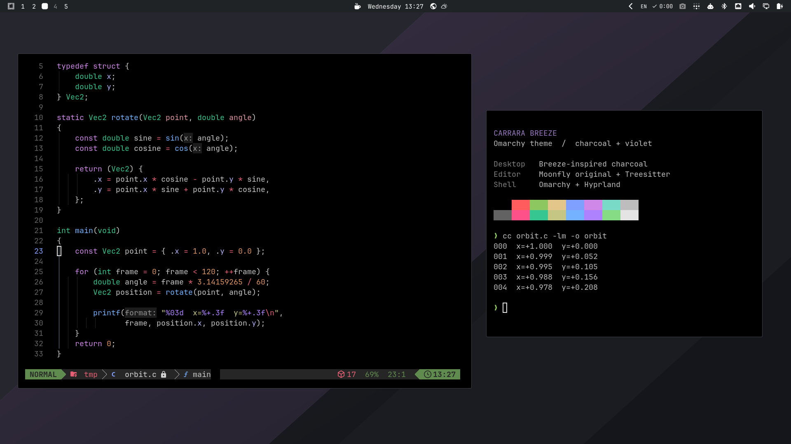

# Carrara Breeze

A dark Omarchy theme inspired by Carrara Software's desktop: charcoal surfaces,
violet accents, a black terminal and Moonfly's terminal/editor palette.



## Install

Requires Omarchy 4.5 or newer with the Omarchy shell.

```bash
omarchy theme install https://github.com/pedrohensto/omarchy-carrara-breeze-theme
```

Then select **Carrara Breeze** in the theme picker (`Super + Ctrl + T`), or run:

```bash
omarchy theme set "Carrara Breeze"
```

### Original Moonfly in Neovim

To use Carrara's actual Neovim colorscheme and CodeDark status line, install
the optional [LazyVim companion](extras/zz-carrara-breeze.lua):

```bash
curl --fail --location --create-dirs \
  https://raw.githubusercontent.com/pedrohensto/omarchy-carrara-breeze-theme/main/extras/zz-carrara-breeze.lua \
  --output ~/.config/nvim/lua/plugins/zz-carrara-breeze.lua
```

Restart Neovim. Lazy installs the original `bluz71/vim-moonfly-colors` plugin.
The companion selects Moonfly without italics, with a transparent background,
and the CodeDark lualine theme only while Carrara Breeze is active. Switching
Omarchy themes restores the normal theme behavior. Existing keymaps and editor
tools are retained. Enable Treesitter for the language you edit for proper
type, variable and function captures.

## Appearance

- Charcoal shell surfaces based on KDE Breeze Dark's Plasma 6.6.4 palette.
- A violet accent matched visually to Carrara's stream.
- A pure-black terminal with Moonfly ANSI colors and light grey text.
- Neovim, Helix, btop and other supported apps generated from `colors.toml`.
- Breeze Dark icons, where installed; `breeze-icons` supplies these on Arch.
- An original, understated geometric wallpaper, with its editable SVG source.

The theme uses Omarchy's normal Hyprland desktop. No KDE session, tiling script,
font, editor extension or executable hook is installed.

## Fidelity and local options

This is an adaptation, not Carrara's exported desktop configuration. His current
public Neovim configuration uses **Moonfly** with no italics and a transparent
background, plus **CodeDark** for lualine. The distributed theme uses Omarchy's
generated Aether colorscheme with Moonfly colors unless the optional companion
above is installed. The companion uses Moonfly's original highlight groups.

Omarchy strips Lua and terminal configuration overrides when installing a theme
from a repository. Therefore the published theme keeps to `colors.toml`,
`shell.toml`, icons and backgrounds. Optional exact Moonfly/CodeDark and compact
window settings are documented in [Local options](docs/LOCAL-OPTIONS.md).

The preview shows a real Omarchy session with Alacritty and Neovim using the
optional original Moonfly companion, CodeDark and C Treesitter highlighting.
Window geometry and font sizes in the screenshot are local presentation settings.

See [References](docs/REFERENCES.md) for verified sources and the remaining
visual approximations. Tested on Omarchy 4.5.0-3.

## Customize

Edit `colors.toml` for terminal/editor colors and `shell.toml` for shell surfaces,
then reapply the theme. User terminal font and padding preferences remain in
the terminal's own configuration.

## Credits and license

- Carrara Software: visual inspiration and public Neovim configuration.
- KDE Breeze: desktop color references.
- [vim-moonfly-colors](https://github.com/bluz71/vim-moonfly-colors): ANSI and editor palette (MIT).
- Omarchy: shell template and theme generation (MIT).
- Wallpaper and theme integration: Pedro Henrique Santos Moreira.

MIT; see [LICENSE](LICENSE). This project is not affiliated with or endorsed by
Carrara Software, KDE or Omarchy.
